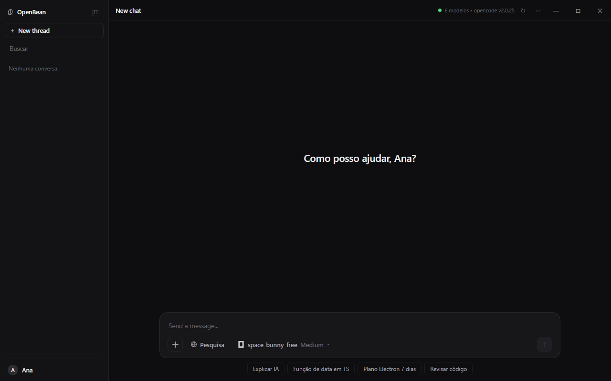
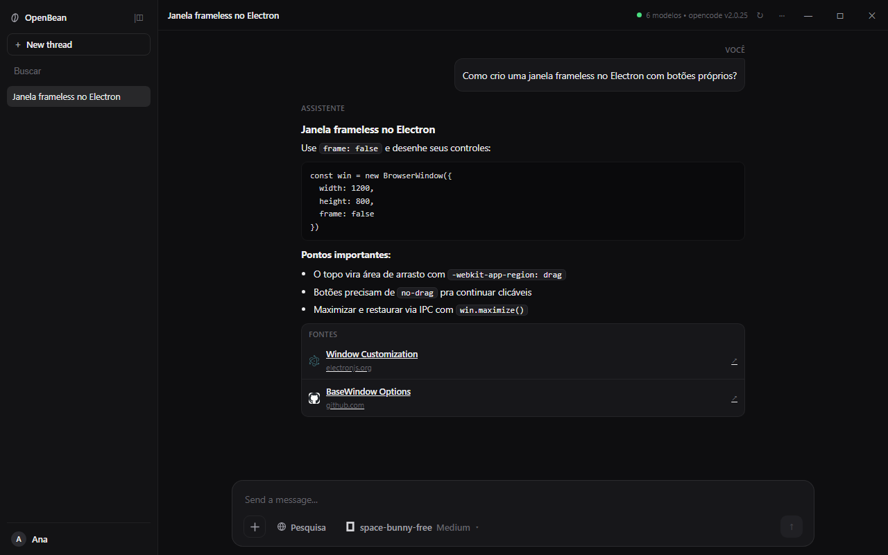
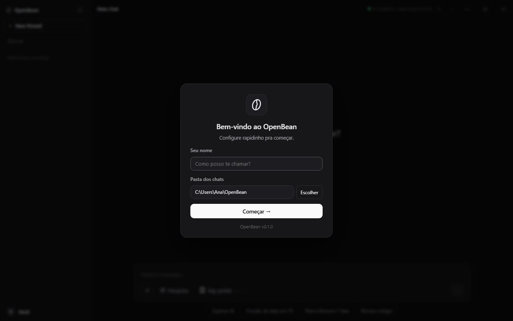

<p align="center">
  
</p>

<h1 align="center">OpenBean</h1>

<p align="center">Assistente IA para desktop com cara de app moderno — e os modelos do seu <b>OpenCode local</b>.</p>

<p align="center">
  
  
  
  
  
</p>

## Screenshots

| Boas-vindas | Conversa com fontes | Configuração inicial |
|---|---|---|
|  |  |  |

## Sobre

O **OpenBean** é um assistente de IA em Electron com interface dark minimalista. Em vez de chamar APIs de nuvem com sua chave, ele conversa com o **OpenCode que já roda na sua máquina** (`opencode api`), então você usa os mesmos modelos gratuitos do OpenCode sem configurar nada de credencial.

- **Chat multi-conversa** com histórico, busca e Markdown (código, listas, links)
- **Modelos + níveis de pensamento** direto do `model.list` (ex: `space-bunny-free` com `Low/Med/High…`), com troca em sessão via `session.switchModel`
- **Pesquisa na web** com bloco de **Fontes** clicáveis (favicon + título + domínio)
- **Anexos**: imagens com thumbnail no chat, arquivos de texto como contexto, vídeos
- **Stop real** (interrompe no servidor e libera a UI na hora) e **failover automático** entre modelos quando o provedor cai (503)
- **Janela frameless** com controles próprios, topbar arrastável e scrollbar customizada
- **Setup inicial**: nome, pasta dos chats e versão do app

## Pré-requisitos

- **Node.js 20+** e npm
- **OpenCode CLI** instalado globalmente (`npm i -g @opencode/cli`) — o app localiza o binário sozinho

## Rodando

```bash
npm install
npm run dev      # desenvolvimento (hot-reload)
```

Builds:

```bash
npm run build        # typecheck + empacota
npm run build:win    # instalador Windows
npm run build:mac    # macOS
npm run build:linux  # Linux
```

Na primeira abertura, o modal pede **seu nome** e a **pasta dos chats** (padrão `~/OpenBean`, criada automaticamente). Depois dá pra editar clicando no seu card na sidebar.

## Como funciona

```
renderer (UI dark) ──IPC──▶ main ──spawn──▶ opencode api <operação> ──▶ OpenCode local
```

O processo `main` (`src/main/opencode-backend.ts`) chama o binário do OpenCode **sem shell** (evita que o `cmd.exe` quebre o JSON) e expõe tudo via IPC (`assistant:*`, `window:*`):

| Fluxo | Operações |
|---|---|
| Listar modelos | `model.list` (fallback: `opencode models`) |
| Conversar | `session.create` → `session.prompt` → `experimental.session.wait` → `session.message.list` |
| Parar | `session.interrupt` + abort local da espera |
| Pesquisa web | `websearch.providers` → `websearch.query` |
| Anexos | `session.prompt` com `files: [{ uri: file://… }]` |

## Estrutura

```
src/
├── main/
│   ├── index.ts            # janela frameless, IPC, config, uploads temp
│   └── opencode-backend.ts # wrapper do CLI (models, sessions, search, failover)
├── preload/
│   └── index.ts            # ponte window.assistant / window.windowControls
└── renderer/
    ├── index.html
    ├── src/renderer.ts     # UI do chat (vanilla TS, sem framework)
    └── assets/main.css     # tema dark + componentes
docs/
├── openbean.svg
└── screenshots/            # prints da interface
```

A config do usuário fica em `<userData>/config.json` (`userName`, `chatsDir`); uploads colados vão para o temp do SO.

## Contribuindo

1. Faça um fork e crie uma branch: `git checkout -b feat/minha-ideia`
2. Rode o projeto com `npm run dev`
3. Garanta `npm run typecheck` e `npm run build` passando
4. Abra um Pull Request descrevendo **o que mudou** e **como testar** (prints ajudam muito)

Boas primeiras issues: streaming de resposta (SSE em `/api/event`), atalhos de teclado, mais providers de favicon, testes automatizados.

## Licença

MIT — veja [LICENSE](LICENSE).
